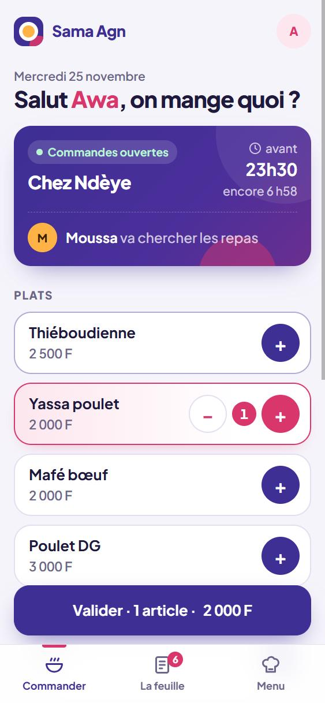
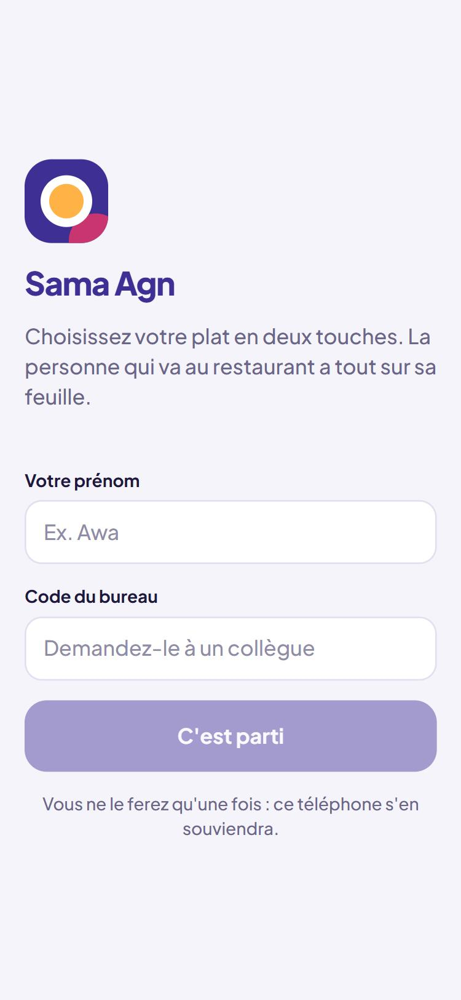
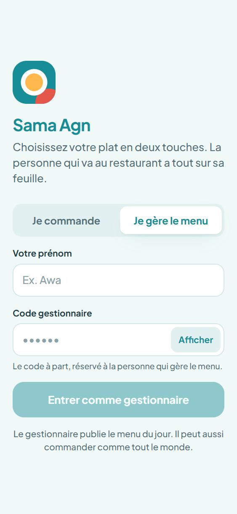
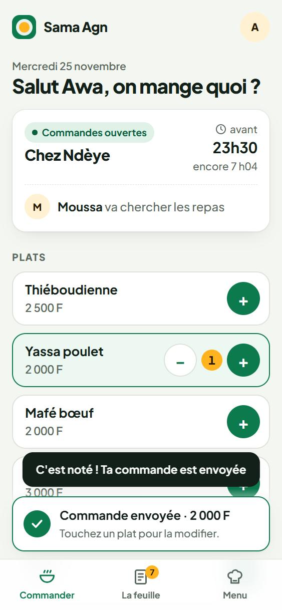
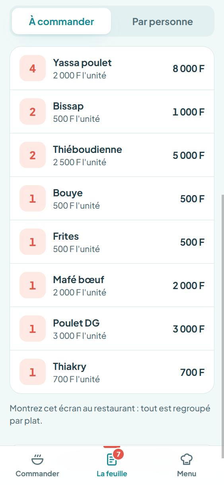
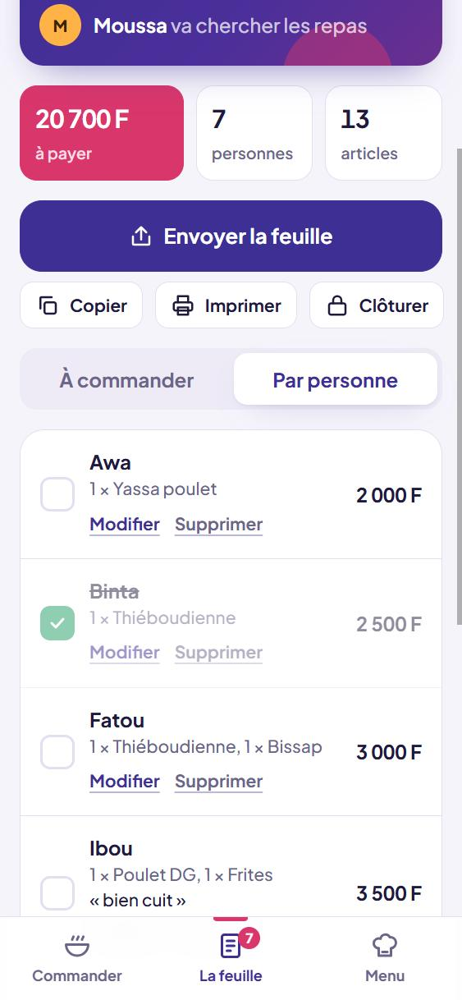

# Sama Agn

*« Mon déjeuner », en wolof.*

Sama Agn est une application web installable sur téléphone (PWA) pour organiser les repas du midi au bureau.

Plus besoin de passer de bureau en bureau pour noter les plats de chacun. Le gestionnaire publie le menu du jour,
chacun choisit sur son téléphone, et la personne qui va au restaurant récupère une feuille récapitulative prête à montrer.

<table>
  <tr>
    <td align="center"><br><sub><b>Commander</b> : on touche un plat, on valide</sub></td>
    <td align="center"><br><sub><b>La feuille</b> : le total et l'envoi en un geste</sub></td>
    <td align="center"><br><sub><b>Menu</b> : on colle le message du restaurant</sub></td>
  </tr>
</table>

## Une journée avec Sama Agn

1. **Le matin**, le gestionnaire colle le menu reçu du restaurant (WhatsApp, SMS). Les plats et les prix sont reconnus tout seuls.
2. **Avant l'heure limite**, chacun ouvre l'app, touche son plat et valide. Un compte à rebours rappelle le temps restant.
3. **Un volontaire** touche « J'y vais ». Il voit la commande regroupée par plat pour le restaurant, et le détail par personne pour la distribution et l'argent.
4. **Il envoie la feuille** sur WhatsApp ou l'imprime, clôture les commandes, puis coche chacun au moment de la distribution.

Tous les écrans se mettent à jour automatiquement, toutes les 5 secondes quand l'app est ouverte.

## Les trois rôles

| Rôle | Connexion | Ce qu'il fait |
| --- | --- | --- |
| **Collègue** | « Je commande », son prénom et le code du bureau. Une seule fois : le téléphone s'en souvient. | Choisit ses plats, ajoute une précision (« sans piment »), modifie sa commande jusqu'à la clôture, et peut reprendre « comme la dernière fois ». |
| **Gestionnaire** | « Je gère le menu » et le code gestionnaire. Il arrive directement sur le menu du jour. | Publie le menu d'aujourd'hui ou de demain : collage du message du restaurant, plats déjà servis ajoutés en un geste, reprise du dernier menu. Il commande aussi comme tout le monde, et peut quitter ce mode depuis son profil. |
| **La personne qui y va** | Pas de compte à part, car ce n'est pas toujours la même personne. Elle touche « J'y vais » sur la carte du jour. | Avec le gestionnaire, elle est la seule à pouvoir clôturer les commandes, ajouter la commande d'un collègue qui a commandé à l'oral, ou en retirer une. |

<details>
<summary><b>Toutes les captures d'écran</b></summary>
<br>

| Connexion collègue | Connexion gestionnaire | Commande envoyée |
| :---: | :---: | :---: |
|  |  |  |
| **À commander au restaurant** | **Par personne (distribution)** | **Pour un collègue** |
|  |  |  |
| **Menu reconnu automatiquement** | | |
|  | | |

</details>

## Pensé pour le téléphone

- **Installable** sur l'écran d'accueil : un bouton « Installer » sur Android ; sur iPhone, un guide « Partager → Sur l'écran d'accueil ».
- **Grandes zones tactiles** (44 px minimum). Pas de zoom involontaire, ni au double tap ni pendant la saisie.
- **Clavier ouvert** : la barre du bas s'efface pour laisser la place au champ.
- **Testé de 320 px (iPhone SE) aux grands écrans**, avec les encoches et la barre d'accueil des iPhone prises en compte.
- **Hors connexion** : l'app s'ouvre quand même et l'indique clairement. Les commandes, elles, partent toujours en direct.

**Identité visuelle « Lagon »**, un seul thème clair :
- bleu lagon (turquoise ciel) pour les actions ;
- corail pour les quantités et le total ;
- mangue pour « J'y vais » ;
- textes gris ardoise plutôt que noirs.

La carte du jour (restaurant, heure limite, qui y va) est un ticket turquoise qu'on repère au premier coup d'œil.

## Technique

| | |
| --- | --- |
| **Interface et serveur** | Next.js 15 (App Router, route handlers), React 19, TypeScript strict |
| **Base de données** | PostgreSQL via `postgres.js`. Le schéma est créé automatiquement au premier appel. |
| **Validation** | Zod sur chaque requête. Les prix sont toujours recalculés côté serveur, jamais repris du téléphone. |
| **PWA** | Manifeste, icônes générées en code, service worker (pages disponibles hors ligne, données toujours en direct) |
| **Tests** | Vitest : analyse des menus collés, totaux, sessions signées, dates et validations |

### Sécurité

- Deux codes distincts : le **code du bureau** pour commander, le **code gestionnaire** pour le menu.
- Session dans un cookie `httpOnly` signé en **HMAC-SHA256** (Web Crypto), vérifiée par le middleware et dans chaque route.
- Codes comparés en temps constant, avec un délai après chaque code faux.
- Droits vérifiés côté serveur : chacun ne modifie que sa propre commande. Seuls le gestionnaire et la personne qui y va peuvent clôturer, ajouter ou supprimer pour les autres.
- En-têtes de sécurité : `X-Frame-Options`, `nosniff`, `Referrer-Policy`, `Permissions-Policy`.

## Lancer le projet en local

Prérequis : Node.js 20 ou plus récent, et Docker pour la base de données.

```bash
npm install
cp .env.example .env.local      # puis choisissez vos codes
npm run db:up                   # PostgreSQL dans Docker (port 5433)
npm run dev                     # http://localhost:3000
```

Les tables sont créées à la première requête. Pour les créer à la main :
`node --env-file=.env.local scripts/migrate.mjs`

### Variables d'environnement

| Variable | Rôle |
| --- | --- |
| `DATABASE_URL` | Adresse de la base PostgreSQL |
| `OFFICE_CODE` | Code donné aux collègues pour entrer dans l'app |
| `ADMIN_CODE` | Code réservé au gestionnaire, différent du précédent |
| `SESSION_SECRET` | Au moins 32 caractères aléatoires, pour signer les sessions |

Pour générer un `SESSION_SECRET` :

```bash
node -e "console.log(require('crypto').randomBytes(32).toString('base64url'))"
```

Changer `SESSION_SECRET` déconnecte tout le monde. Changer `OFFICE_CODE` ne bloque que les nouvelles connexions.

### Commandes utiles

| Commande | Effet |
| --- | --- |
| `npm run dev` | Serveur de développement |
| `npm test` | Tests unitaires |
| `npm run typecheck` | Vérification TypeScript |
| `npm run build` | Version de production |

## Organisation du code

```
app/(app)/            écrans Commander, La feuille, Menu
app/login/            connexion (collègue ou gestionnaire)
app/api/              session, day (menu, statut), order, history
app/icons/[variant]/  icônes de l'app, générées en code
components/           écrans et composants de l'interface
lib/                  logique métier : menus, dates, sessions, accès à la base
db/schema.ts          schéma SQL
public/sw.js          service worker (mode hors ligne)
tests/                tests Vitest
docs/screenshots/     captures d'écran du README
```

---

Réalisé par [Ibrahima Fall](https://github.com/ibrafall-tech).
