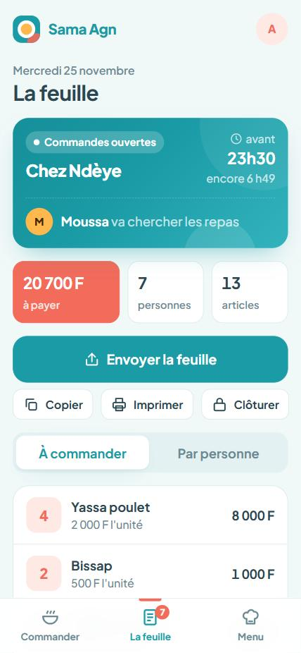
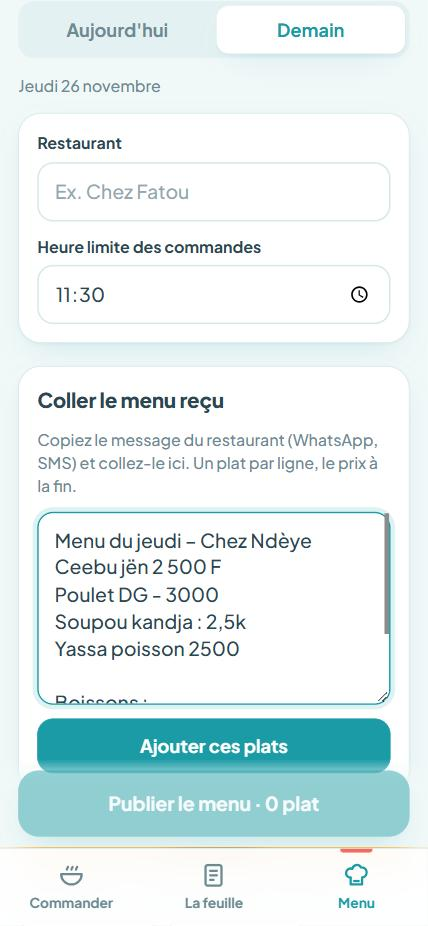
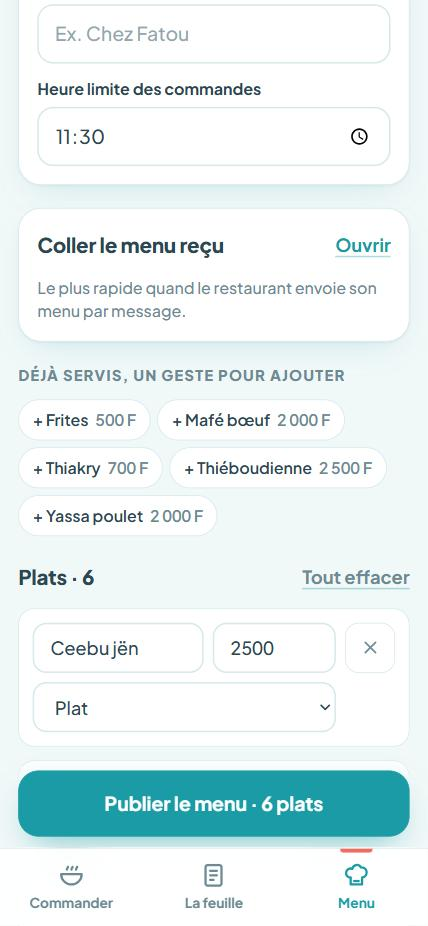
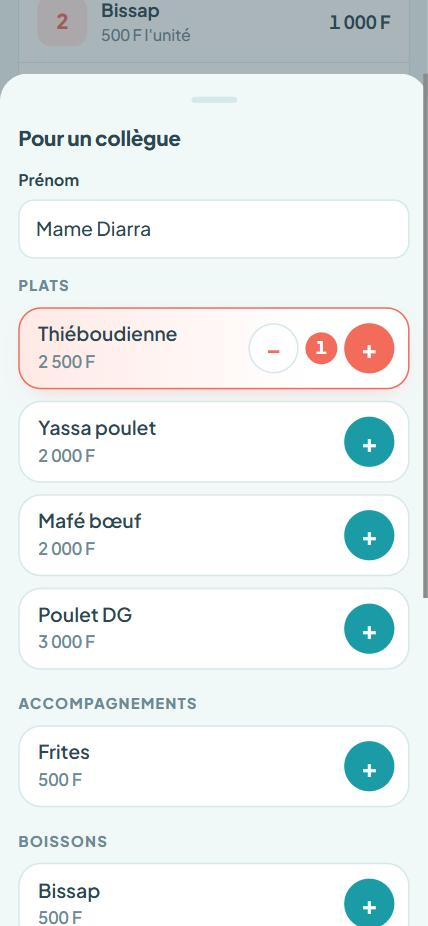

# Sama Agn

*« Mon déjeuner », en wolof.*

Application web installable (PWA) pour commander les repas du midi au bureau.
Fini le tour des bureaux pour noter les plats de chacun : le gestionnaire publie le menu du jour,
chacun choisit sur son téléphone, et la personne qui va au restaurant récupère la feuille récapitulative.

## Aperçu

<table>
  <tr>
    <td align="center"><br><sub><b>Commander</b> : on touche un plat, on valide</sub></td>
    <td align="center"><br><sub><b>La feuille</b> : le total et l'envoi en un geste</sub></td>
    <td align="center"><br><sub><b>Menu</b> : on colle le message du restaurant</sub></td>
  </tr>
</table>

<details>
<summary><b>Toutes les captures</b></summary>
<br>

| Connexion | Commande envoyée | À commander au restaurant |
| :---: | :---: | :---: |
|  |  |  |
| **Par personne (distribution)** | **Menu reconnu automatiquement** | **Pour un collègue** |
|  |  |  |

</details>

## Ce que fait l'app

| Qui | Écran | En pratique |
| --- | --- | --- |
| Tout le monde | **Commander** | Touchez un plat pour l'ajouter, puis « Valider ». Compte à rebours avant l'heure limite, bouton « J'y vais », raccourci « Comme la dernière fois ». |
| La personne qui y va | **La feuille** | Vue « À commander » regroupée par plat (à montrer au restaurant), vue « Par personne » avec cases à cocher pour la distribution et le montant de chacun. Partage WhatsApp, copie, impression, clôture des commandes, ajout pour un collègue. |
| Le gestionnaire | **Menu** | Collez le menu reçu par WhatsApp : les plats et les prix sont reconnus automatiquement. Ajout en un geste des plats déjà servis, reprise du dernier menu, préparation du menu du lendemain. |

Les écrans se mettent à jour tout seuls (toutes les 5 secondes quand l'app est ouverte).

**Identité visuelle « Lagon »** : un seul thème clair. Bleu lagon (turquoise ciel) pour les actions,
corail pour les quantités et le total, mangue pour « J'y vais », fond blanc d'eau et textes ardoise doux
plutôt que noirs. La carte du jour (restaurant, heure limite, qui y va) est un ticket turquoise
reconnaissable au premier coup d'œil.

## Stack

- **Next.js 15** (App Router, route handlers) + **React 19**, TypeScript strict
- **PostgreSQL** (Neon en production, Docker en local) via `postgres.js`, schéma créé automatiquement
- **Zod** pour valider chaque requête ; les prix sont toujours recalculés côté serveur
- **PWA** : manifeste, icônes générées en code, service worker (pages hors ligne, API toujours en direct)
- **Vitest** : tests de l'analyse des menus, des totaux, des sessions signées et des validations

## Sécurité

- Accès par **code du bureau** ; un **code gestionnaire** séparé pour le menu et la clôture.
- Session en cookie `httpOnly` signé **HMAC-SHA256** (Web Crypto), vérifié dans le middleware et dans chaque route.
- Comparaison des codes en temps constant et délai après un code faux.
- Droits vérifiés côté serveur : chacun ne modifie que sa commande ; seuls le gestionnaire ou la personne qui y va
  peuvent clôturer, ajouter ou supprimer pour les autres.
- En-têtes de sécurité (`X-Frame-Options`, `nosniff`, `Referrer-Policy`, `Permissions-Policy`).

## Lancer en local

```bash
npm install
cp .env.example .env.local      # puis ajustez les codes
npm run db:up                   # Postgres dans Docker (port 5433)
npm run dev                     # http://localhost:3000
npm test                        # tests unitaires
```

Les tables sont créées au premier appel. `npm run db:migrate` les crée à la main si besoin
(`node --env-file=.env.local scripts/migrate.mjs`).

## Déployer sur Vercel

1. Poussez le dépôt sur GitHub, puis **Add New → Project** sur Vercel et importez-le.
2. Dans le projet : **Storage → Create Database → Neon (Postgres)**, et connectez-la au projet.
   La variable `DATABASE_URL` est ajoutée automatiquement.
3. **Settings → Environment Variables**, ajoutez :
   - `OFFICE_CODE` : le code que vous donnerez aux collègues
   - `ADMIN_CODE` : le code du gestionnaire (différent !)
   - `SESSION_SECRET` : 32 caractères aléatoires ou plus
     (`node -e "console.log(require('crypto').randomBytes(32).toString('base64url'))"`)
4. **Deploy**. Ouvrez l'URL sur votre téléphone :
   - Android (Chrome) : bouton « Installer l'app » en haut de l'écran.
   - iPhone (Safari) : Partager → « Sur l'écran d'accueil ».

Changer `SESSION_SECRET` déconnecte tout le monde ; changer `OFFICE_CODE` n'empêche que les nouvelles connexions.

## Structure

```
app/(app)/            écrans Commander, La feuille, Menu
app/api/              session, day (menu, statut), order, history
app/icons/[variant]/  icônes PWA générées
components/           écrans et composants client
lib/                  logique métier (menu, temps, sessions, accès base)
db/schema.ts          schéma SQL
public/sw.js          service worker
tests/                tests Vitest
```
